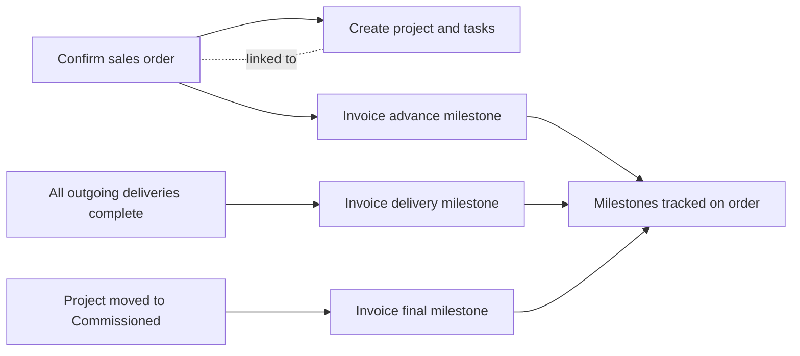

# Project Milestone Billing

[](https://www.odoo.com/)
[](https://www.gnu.org/licenses/lgpl-3.0.html)
[](#)

**Automate project billing around the milestones that move solar work forward.**

Configure a percentage-based billing plan on a sales order. Order confirmation, completed delivery, and project commissioning can each trigger the corresponding invoice, while the project and its starter tasks are created alongside the order.

## Billing Flow



The included **30% / 50% / 20%** plan demonstrates advance, delivery, and commissioning billing. The final milestone uses Odoo's native delivered-invoice flow so existing down payments are handled by Odoo.

## What It Does

| Area | Behavior |
| --- | --- |
| Billing plans | Define named milestones and percentages; plans must total exactly 100%. |
| Sales orders | Generate milestones from the selected plan when the order is confirmed. |
| Project setup | Create a linked project, starter tasks, and analytic distribution for order lines. |
| Invoice triggers | Invoice advance on confirmation, delivery after all outgoing pickings finish, and commissioning when the project enters its trigger stage. |
| Recovery | Log automatic invoice failures on the sales order without blocking delivery validation or stage changes. |
| Controls | Prevent deleting invoiced milestones and regenerating a plan after any milestone has been invoiced. |

## Requirements

- Odoo **17.0**
- Odoo modules: `sale_management`, `sale_stock`, `project`, and `account`
- Custom addon: `solar_security` (required by this module's manifest)

## Install

1. Place this repository in a directory on the Odoo addons path.
2. Ensure `solar_security` and the Odoo dependencies are installed and available on the addons path.
3. Restart Odoo, update the Apps list, and install **Project Milestone Billing** (`project_milestone_billing`).

To update an existing database from the command line:

```bash
./odoo-bin -d <database> -u project_milestone_billing --stop-after-init
```

## Tests

The addon includes transaction tests for percentage validation and the order-confirmation flow. Run them in an Odoo test environment with this module and its dependencies available:

```bash
./odoo-bin -d <test-database> -i project_milestone_billing --test-enable --test-tags /project_milestone_billing --stop-after-init
```

## License

This project is distributed under the **LGPL-3** license, as declared in the module manifest.